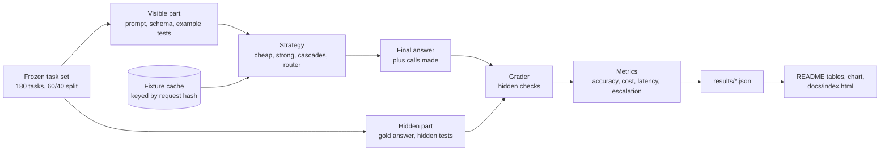
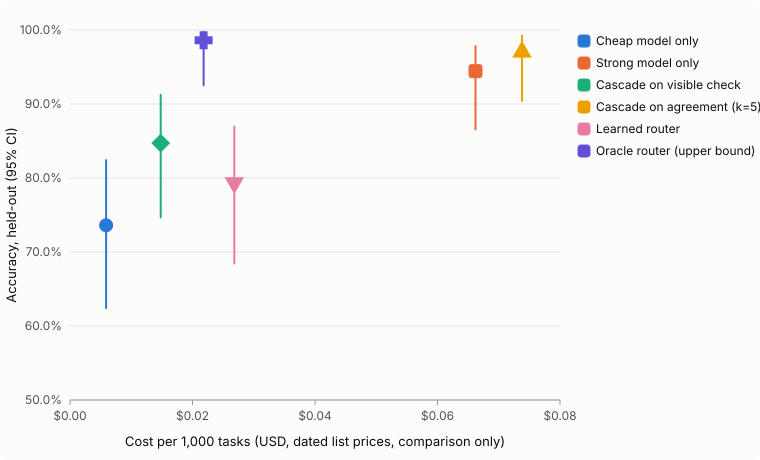

# cascadelab

[](https://github.com/shreyas-tech7/cascadelab/actions/workflows/ci.yml)

**Status:** release candidate v0.1.0-rc1. Every number below comes from a **fake model pair** replayed from fixtures, because the build machine had no provider key. Record mode for real free models is written and tested, but not run yet. Treat the numbers as a worked example of the method, not as facts about real models.

When a cheap model is enough, measured.

## The problem

You pay for model calls, and someone suggests a router or a cascade to cut the bill. Papers report big savings. FrugalGPT reported a learned cascade that matched the best single model at up to 98% lower cost ([paper](https://arxiv.org/abs/2305.05176)). RouteLLM reported cost cuts of over 85% on MT Bench, 45% on MMLU and 35% on GSM8K against always calling the strong model ([project page](https://sky.cs.berkeley.edu/project/routellm/)). Later reviews ask whether routers trained on one data set carry over to another ([review](https://web.stanford.edu/~shuhuiq/blog/review-routing-cascades.html)).

cascadelab is a small lab you can rerun for free. It uses tasks that a program can grade: math word problems, JSON extraction and small Python functions. It runs six strategies on the same tasks and reports accuracy with intervals, cost, latency and escalation rate.

One rule holds the lab together. Each task has **visible checks** (what a real system can run at run time: the answer format, the JSON schema, the example tests in the task text) and **hidden checks** (the gold answer and the hidden tests). Strategies may use visible checks only. Hidden checks are for scoring only, and a test proves that no hidden data reaches strategy code.

## How it works



The six strategies:

1. **Cheap model only** and **strong model only**: the two baselines.
2. **Cascade on visible check**: ask the cheap model, run the visible check, and ask the strong model only if the check fails.
3. **Cascade on agreement**: sample the cheap model several times, and ask the strong model if the samples disagree.
4. **Learned router**: a hash embedding of the task text plus logistic regression predicts whether the cheap model will fail. It trains on the development split only.
5. **Oracle router**: knows from the hidden check whether the cheap answer is right. It is an upper bound, never a claim.

## Results

<!-- context:start -->
Held-out split, 72 tasks. Models: `fake-cheap` (priced as llama-3.1-8b-instant on Groq) and `fake-strong` (priced as llama-3.3-70b-versatile on Groq). Fixtures `fake-seed0` recorded 2026-11-23 by the fake provider, fake seed 0. Price table checked 2026-11-23. Agreement cascade k = 5. Router embedder `hash-512`. Bootstrap 2000 resamples, seed 0.
<!-- context:end -->

<!-- results:start -->
| Strategy | Accuracy (95% CI) | vs strong only, points (paired 95% CI) | Cost per 1,000 tasks | Latency p50 / p95 | Escalation rate | Calls per task |
| --- | --- | --- | --- | --- | --- | --- |
| Cheap model only | 73.6% (62.4% to 82.4%) | -20.8 (-33.3 to -9.7) | $0.0059 | 236 / 331 ms | 0.0% | 1.00 |
| Strong model only | 94.4% (86.6% to 97.8%) | baseline | $0.0662 | 846 / 1174 ms | 0.0% | 1.00 |
| Cascade on visible check | 84.7% (74.7% to 91.2%) | -9.7 (-19.4 to +0.0) | $0.0148 | 259 / 1179 ms | 12.5% | 1.12 |
| Cascade on agreement (k=5) | 97.2% (90.4% to 99.2%) | +2.8 (+0.0 to +6.9) | $0.0738 | 782 / 1381 ms | 68.1% | 5.68 |
| Learned router | 79.2% (68.4% to 86.9%) | -15.3 (-25.0 to -6.9) | $0.0268 | 281 / 1150 ms | 33.3% | 1.00 |
| Oracle router (upper bound) | 98.6% (92.5% to 99.8%) | +4.2 (+0.0 to +9.7) | $0.0218 | 270 / 1080 ms | 26.4% | 1.00 |
<!-- results:end -->



The chart and the table come from `results/fake-seed0.json`. The [static results page](docs/index.html) also shows the development split and the second seed.

A second, independent draw of the fake pair moves the numbers by a few points. That is the honest size of the noise here:

<!-- seeds:start -->
| Strategy | Accuracy, seed 0 | Accuracy, seed 1 | Cost per 1,000, seed 0 | Cost per 1,000, seed 1 |
| --- | --- | --- | --- | --- |
| Cheap model only | 73.6% | 65.3% | $0.0059 | $0.0059 |
| Strong model only | 94.4% | 88.9% | $0.0662 | $0.0660 |
| Cascade on visible check | 84.7% | 77.8% | $0.0148 | $0.0192 |
| Cascade on agreement (k=5) | 97.2% | 90.3% | $0.0738 | $0.0703 |
| Learned router | 79.2% | 73.6% | $0.0268 | $0.0239 |
| Oracle router (upper bound) | 98.6% | 93.1% | $0.0218 | $0.0264 |
<!-- seeds:end -->

<!-- router:start -->
The learned router scores 90.7% on the development split it trained on and 79.2% on the held-out split. The splits differ in difficulty, so compare its gain over cheap only instead: +13.9 points on development and +5.6 on held-out. The gain shrinks on tasks it never saw, which is the overfit the held-out split exists to show. It trained on 108 development tasks with the `hash-512` embedder.
<!-- router:end -->

## Cost per task

<!-- cost:start -->
Strong only costs $0.0662 per 1,000 held-out tasks at the dated list prices. Here is what each other strategy costs, and how much it saves against strong only:

- Cheap model only: $0.0059 per 1,000 tasks, 91.1% saved (paired difference -$0.0603, 95% CI -$0.0663 to -$0.0543).
- Cascade on visible check: $0.0148 per 1,000 tasks, 77.6% saved (paired difference -$0.0514, 95% CI -$0.0585 to -$0.0441).
- Cascade on agreement (k=5): $0.0738 per 1,000 tasks, 11.5% more than strong only (paired difference $0.0076, 95% CI -$0.0003 to $0.0157).
- Learned router: $0.0268 per 1,000 tasks, 59.5% saved (paired difference -$0.0394, 95% CI -$0.0478 to -$0.0311).
- Oracle router (upper bound): $0.0218 per 1,000 tasks, 67.1% saved (paired difference -$0.0444, 95% CI -$0.0520 to -$0.0363).

These dollars are a comparison only. The runs in this repo cost $0: the fixtures come from the fake model pair, and record mode targets free tiers.
<!-- cost:end -->

The price table is `data/prices.json`. It holds Groq's last public list prices for llama-3.1-8b-instant and llama-3.3-70b-versatile, with the date it was checked and its source. A later record says Groq moved both models to enterprise pricing, so the table is a dated comparison, not a quote.

Why paired intervals:

<!-- paired:start -->
Pairing helps most when two strategies share outcomes. The cascade on a visible check and cheap only have the same outcome on 88.9% of held-out tasks. The paired 95% interval on their accuracy difference is 13.9 points wide, and resampling them separately gives 27.8 points. Against strong only the two share outcomes on 81.9% of tasks, and the widths are 19.4 paired and 19.4 unpaired. Pairing gains little there, because the fake models fail independently of each other. Real models tend to fail on the same hard tasks, which makes pairing worth more.
<!-- paired:end -->

## Run it in 10 minutes

You need Python 3.11 or newer and git. No key and no network after the install.

```bash
git clone https://github.com/shreyas-tech7/cascadelab.git
cd cascadelab
./init.sh                      # venv, install, lint, link check, frozen-task check, offline tests
.venv/bin/cascadelab run       # replay every strategy from fixtures into results/
.venv/bin/cascadelab report    # rewrite the README tables, chart and docs/index.html
.venv/bin/cascadelab demo      # a short transcript of what each strategy did
```

`git diff` after `run` and `report` should show nothing, because the replay is byte for byte.

To record real models (this needs a free key, see [docs/HUMAN_STEPS.md](docs/HUMAN_STEPS.md)):

```bash
export GROQ_API_KEY=...        # or OPENROUTER_API_KEY with --provider openrouter
.venv/bin/cascadelab record --provider groq --cheap SMALL_MODEL --strong LARGE_MODEL --limit 200
.venv/bin/cascadelab run --fixtures groq
```

`record` resumes where it stopped, so you can spread the calls over several days of free limits.

## Limits

- **The models are fakes.** The cheap fake fails more often on harder tasks, and a fixed share of its wrong answers fail the visible check (`fakes.VISIBLE_SHARE`). Those shares decide how well the cascade on a check can do. Real models will differ.
- The held-out split is small, so the intervals are wide. A difference of a few points is inside the noise.
- The router uses a hash embedding, not a learned one, because the embedding model download was blocked. Set `CASCADELAB_FASTEMBED=1` where Hugging Face is reachable.
- Latency is the sum of recorded call latencies (the slowest one for parallel samples). Time spent running checks is left out, so replay stays byte for byte.
- Code answers run in a subprocess with a timeout, CPU and memory limits, in a temp folder. That is not a full sandbox.
- Agreement on code compares normalized source text, so two correct programs written differently count as a disagreement. And if all samples agree, the agreement cascade keeps the answer even when it fails the visible example tests.
- The tasks are synthetic and templated. They are easier to check than most real work.

## Glossary

- **Cascade:** try the cheap model first and move up to the strong model only when a signal says the cheap answer is bad.
- **Router:** decide before any call which model gets the task.
- **Escalation rate:** the share of tasks that reach the strong model.
- **Visible check:** a check a real system can run at run time, with no answer key.
- **Hidden check:** the answer key and hidden tests, used only for scoring.
- **Paired bootstrap:** resample tasks, and compare two strategies on the same resampled tasks.
- **Fixture:** a recorded model call, stored by a hash of the request, so a run replays exactly.
- **Oracle:** a router that knows the right answer. It sets the ceiling.

## Related work

FrugalGPT ([paper](https://arxiv.org/abs/2305.05176)), RouteLLM ([project page](https://sky.cs.berkeley.edu/project/routellm/)) and AutoMix study cascades and routers. RouterArena compares routers across data sets. cascadelab adds program checkers, the visibility rule and full offline replay, so anyone can rerun the numbers for free.

## How this was built

AI agents wrote most of the code under Shreyas's direction, from the brief in [docs/build/BUILD_PROMPT.md](docs/build/BUILD_PROMPT.md). Design choices are in [DECISIONS.md](DECISIONS.md), and a plain tour of every file is in [docs/WALKTHROUGH.md](docs/WALKTHROUGH.md).

Human checks, not done yet:

- Shreyas has not yet read the diff or rerun `./init.sh` on his own machine.
- Nobody has run record mode on real models yet.
- Nobody has hand-checked a sample of the tasks yet.

MIT license. See [LICENSE](LICENSE).
